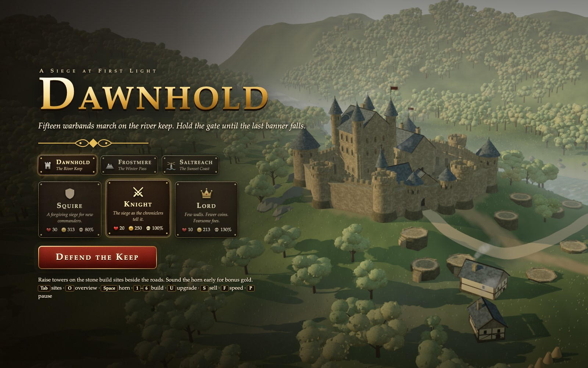
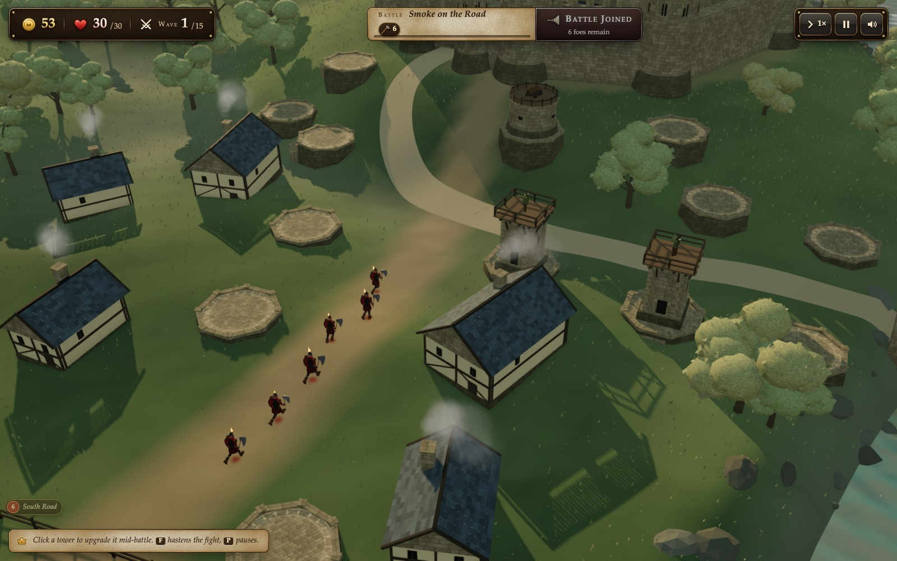
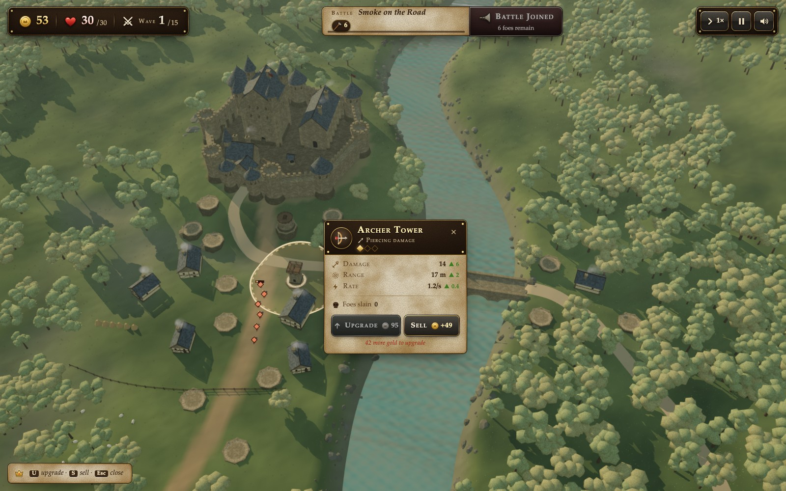
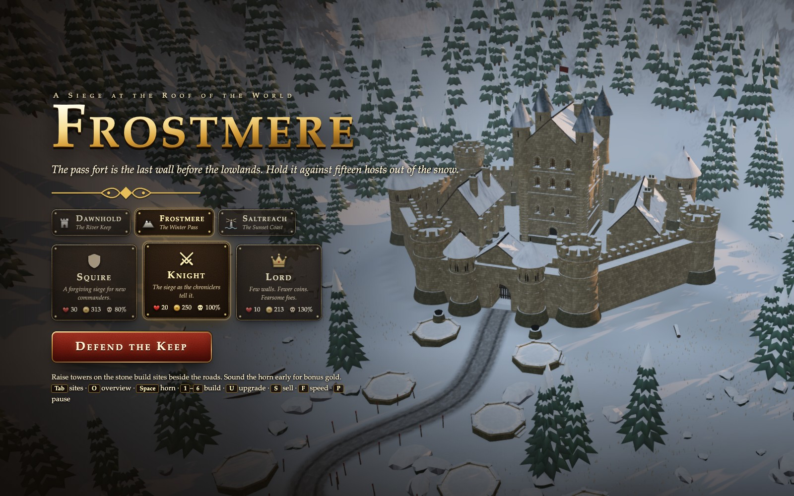
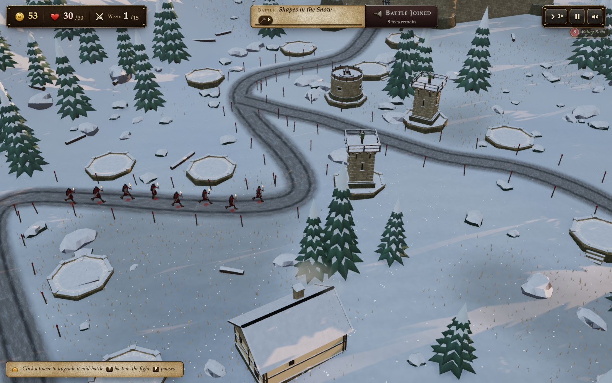
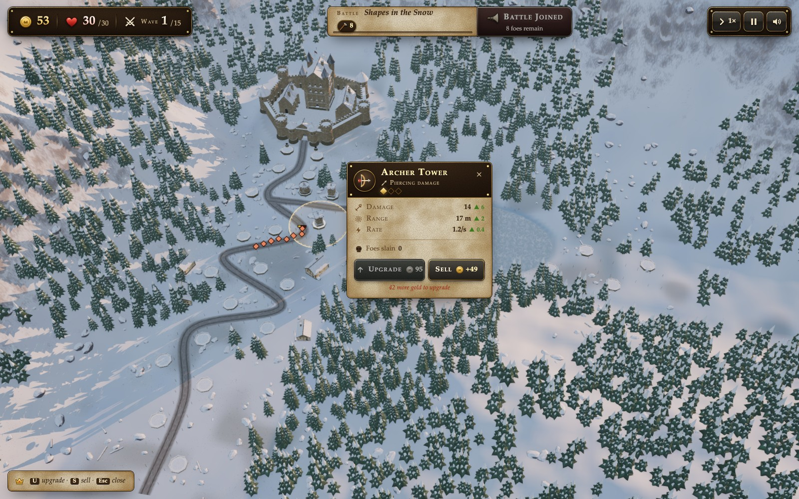
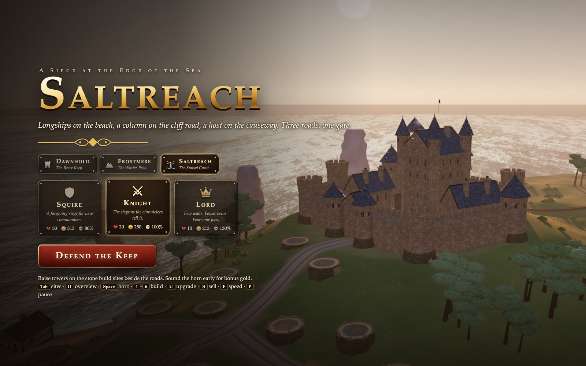
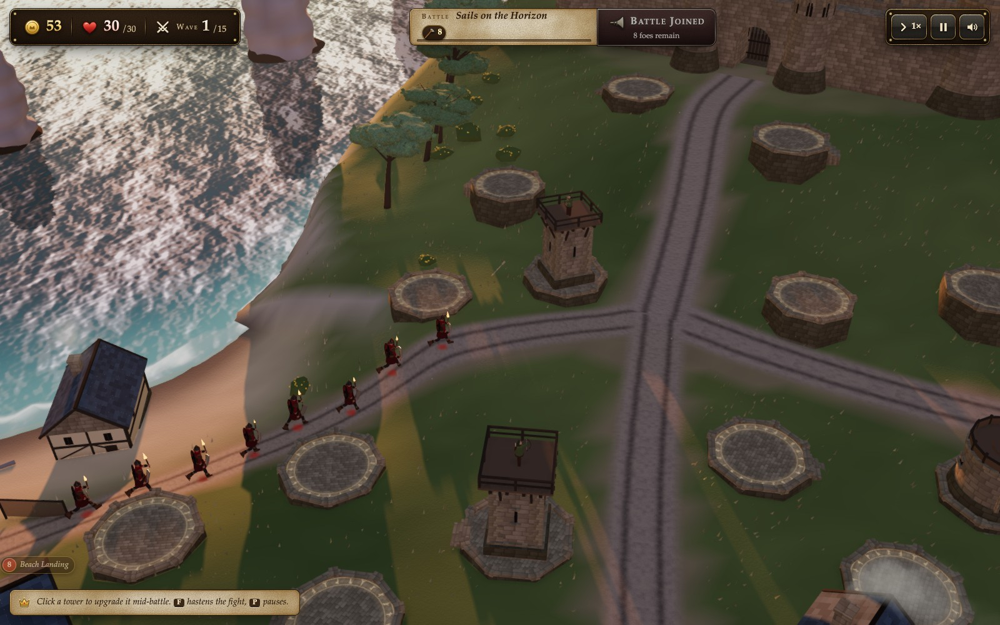
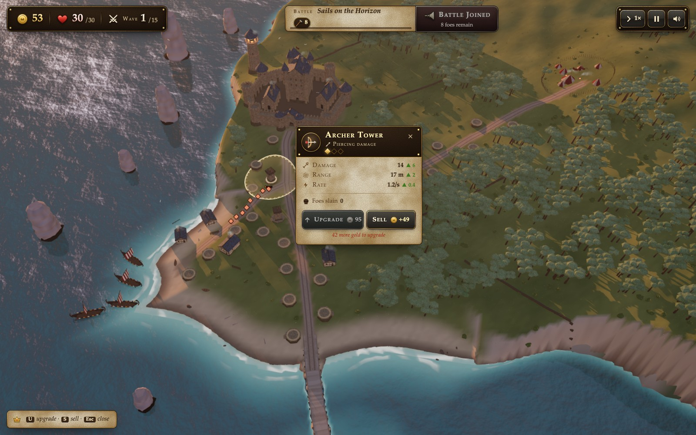

# Castle Defense

Castle Defense is a browser tower-defense game built with Three.js. Defend the gate through 15 waves, build and upgrade towers, and choose between three battlefields and three difficulty settings.

## Gameplay gallery

Each battlefield has a title screen, a live combat view, and a tower-management view. Battles use Squire difficulty with the normal starting gold and tower costs. The game continues running while the tower card is open.

### Dawnhold

Defend the river keep and its village roads.





### Frostmere

Hold the fortress above the snowy mountain pass.





### Saltreach

Guard the coastal fortress and its three approaches.





## Run the local preview

Use Node.js and npm. Node.js 24 is the development runtime used for the build and preview checks. Run these commands from the repository root:

```bash
npm ci --prefix work
node work/preview.mjs
```

Open [the local preview](http://127.0.0.1:32947/). The server builds `outputs/castle-defense.html` before listening and watches the imported game sources for changes. Keep the terminal process running while you develop. Stop it with Ctrl+C.

After a successful rebuild, reload the browser. There is no automatic browser reload. Reloading starts a fresh game. Changes to `work/build.mjs` or `work/preview.mjs` require restarting the preview process.

The server listens only on `127.0.0.1:32947`. Both `/` and `/castle-defense.html` serve the game with caching disabled. Query parameters work on either route, for example [Frostmere](http://127.0.0.1:32947/?level=frostmere). Other paths return 404. A busy port prevents the preview from starting.

## Build an offline game

```bash
node work/build.mjs
node work/build.mjs dev-example
node work/build.mjs --watch
node work/build.mjs dev-example --watch
```

The command syntax is `node work/build.mjs [name] [--watch]`.

- `name` is the output basename without `.html`. It defaults to `castle-defense`.
- `--watch` performs an initial build and rebuilds when imported source files change. It does not start an HTTP server.
- The output is `outputs/<name>.html`. Names beginning with `dev-` produce Git-ignored HTML files.

The preview already runs a watcher for `castle-defense`; use the standalone watcher when you do not need the preview server. Avoid running multiple builders for the same output file.

The watcher follows imports from `work/game/main.js`, including the scene, worlds, game modules, and their helpers. Documentation, test scripts, and unrelated files in `work/` do not trigger game builds. A failed rebuild reports the error and preserves the last successful HTML. Fixing the source triggers another build. An initial build failure exits the command.

The HTML contains the bundled JavaScript, Three.js, shaders, and styles. Models, textures, and audio are generated by the game. You can open or distribute the HTML as a single offline file. The browser does not load the source files from `work/`. Edit the source and rebuild; direct edits to generated HTML are overwritten.

## Play

Choose Dawnhold (`castle`), Frostmere (`frostmere`), or Saltreach (`saltreach`) on the title screen. Select Squire, Knight, or Lord difficulty. Arrow keys choose a focused battlefield or difficulty card, and Enter begins the siege. Loading another battlefield reloads the page.

Click or tap a stone build site to choose a tower. Select a tower to upgrade or sell it. Sound the horn early for bonus gold.

| Input | Action |
| --- | --- |
| Drag | Orbit the camera |
| Right-drag or two-finger drag | Pan |
| Scroll or pinch | Zoom |
| Double-click | Reframe the camera |
| Tab / Shift+Tab during play | Move through build sites |
| Arrow keys with a site selected | Move between sites |
| Number keys | Build the corresponding tower on a selected or hovered site |
| U / S | Upgrade / sell the selected tower |
| Space | Sound the next wave |
| F | Cycle 1×, 2×, and 3× game speed |
| P | Pause or resume |
| M | Toggle sound |
| O / Home | Show the battlefield overview |
| Escape | Close the selection, or toggle pause |

Sound starts after a user interaction. Mute preference and best crown scores per battlefield and difficulty are stored in local storage. Level and difficulty choices use session storage. Hiding the browser tab pauses the siege. Announcements wait while paused or while a build menu or tower card is open.

## Source structure

| Path | Responsibility |
| --- | --- |
| `work/game/main.js` | Entry point, module initialization, and per-frame game updates |
| `work/game/core.js` | Shared state, event bus, and enemy lanes |
| `work/game/enemies.js`, `towers.js` | Enemy behavior, tower building, combat, and projectiles |
| `work/game/ui.js`, `waves.js` | Input, menus, HUD, difficulty, and wave flow |
| `work/game/fx.js`, `audio.js` | Visual effects and procedural Web Audio |
| `work/game/*-models.js`, `audio-synth.js`, `ui-style.js` | Models, sound synthesis, and interface styling |
| `work/scene.js` | Renderer, camera, materials, shared geometry helpers, and render loop |
| `work/worlds/` | Battlefield geometry and shared fortress components |
| `work/level.js` | Level metadata and selection for the current page load |
| `work/build.mjs`, `preview.mjs` | HTML bundling, watching, and local HTTP preview |
| `outputs/castle-defense.html` | Generated playable game |

The render loop targets 60 updates per second and skips rendering while the document is hidden. Gameplay time respects pause and game speed. The scheduler resets its timing when visibility changes and limits the simulation delta after long frames. Reduced-motion preferences disable world animation.

See the [module contract](work/game/CONTRACT.md) for APIs, events, world data, and debug helpers.

## Verify changes

These checks run without a browser:

```bash
node work/build-test.mjs
node work/perf-scheduler-test.mjs
```

The build test creates a temporary fixture, builds a custom output, and runs a temporary preview on an ephemeral port. It checks HTTP routes, query parameters, rebuilds, preservation of valid HTML after a syntax error, and recovery. It cleans up its process and temporary files. The scheduler test checks frame timing behavior.

The browser tools use Playwright from `devDependencies` in `work/package.json`. Install dependencies with `npm ci --prefix work`, then install Chromium:

```bash
npm exec --prefix work -- playwright install chromium
```

Build the requested HTML before running browser tools. GPU launch options use Metal on macOS and the browser defaults on other platforms.

| Command | Purpose and options |
| --- | --- |
| `node work/gallery.mjs` | Capture nine images in `docs/screenshots/`: title screens, live combat, and tower management for all three levels. It uses normal game APIs to spend starting gold and keyboard/mouse input to start combat and select towers. It records the HTML SHA-256 and scene state in `manifest.json`, and rejects browser errors or external HTTP requests. |
| `node work/shot.mjs <name> <out.png> [--size 1600x900] [--eval "<js>"] [--wait 3000]` | Screenshot a built game; `name` excludes `.html`. |
| `node work/playtest.mjs [name] [speed] [level]` | Play through via input. Defaults to `castle-defense` and speed `3`. Create `work/shots/play/` first. |
| `node work/game/audio-test.mjs [name] [level]` | Check synthesized sounds and mixes for clipping, silence, and duration. Default output name is `dev-audio`. |
| `node work/drive.mjs <steps.mjs> [--size 1440x900] [--level frostmere] [--touch] [--out run] [--html castle-defense]` | Run scripted UX steps and save screenshots under `work/shots/ux/<out>/`. The steps file default-exports an async function receiving `{ page, shot, padXY, wait }`. |
| `node work/perf.mjs [name] [level]` | Measure GPU rendering cost, draw calls, and triangles during battle. |
| `node work/perf-full.mjs <before.html> [after.html] [rounds] [report.json]` | Measure complete frames across levels. Defaults to comparing the first file with itself, five rounds, and `/tmp/castle-perf.json`. |
| `node work/perf-verify.mjs <before.html> <after.html> [output-dir]` | Compare deterministic gameplay and rendered pixels. Default directory is `/tmp/castle-perf-verify`. |

For example:

```bash
node work/build.mjs dev-audio
node work/game/audio-test.mjs dev-audio castle
node work/shot.mjs castle-defense work/shots/title.png --size 1600x900
```

`work/verify.mjs` targets the absent `outputs/castle-at-dawn.html` and checks a scene with no visible text. It is not a verification command for Castle Defense. Screenshots and active gameplay inspection are needed to assess visual quality; passing script checks alone does not establish it.

## License

The project source and gameplay screenshots are distributed under the [MIT license](LICENSE). Three.js retains its own MIT copyright notice; see [third-party notices](THIRD_PARTY_NOTICES.md). The standalone HTML includes both full MIT license texts.

See the [publication review](docs/publication-review.md) for the audit scope, checks, and remaining release decisions.
